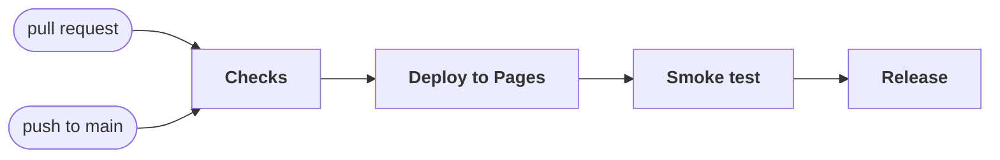

# Envoid Design Studio

Marketing website for Envoid Design Studio, an architecture and interior design practice in Vaishali, Ghaziabad.

[](https://github.com/hamza-aziz-ai/envoid-design-studio/actions/workflows/deploy.yml)
[](https://envoiddesign.in/)

**Production:** <https://envoiddesign.in/>

---

## Contents

- [Overview](#overview)
- [Architecture](#architecture)
- [Repository structure](#repository-structure)
- [Local development](#local-development)
- [Quality gates](#quality-gates)
- [Delivery pipeline](#delivery-pipeline)
- [Branching and merge policy](#branching-and-merge-policy)
- [Hosting, DNS and domain](#hosting-dns-and-domain)
- [Content and asset conventions](#content-and-asset-conventions)
- [Operations runbook](#operations-runbook)
- [Security considerations](#security-considerations)
- [Outstanding items](#outstanding-items)

---

## Overview

Five static pages, hand-written in HTML, CSS and JavaScript. There is no framework, no bundler and no `node_modules`; the only external resources the browser fetches are Google Fonts and the EmailJS SDK. Opening `index.html` from disk gives a working site.

That constraint is deliberate. The site is content that changes a few times a year, and a toolchain it does not need is a dependency surface it would have to maintain. The engineering investment sits instead in the delivery pipeline: every push is validated, deployed, probed against the live origin and released, with no manual step between a merge and production.

| | |
| --- | --- |
| **Runtime** | Static HTML, CSS, vanilla JavaScript (no build step) |
| **Hosting** | GitHub Pages, deployed from GitHub Actions |
| **Domain** | `envoiddesign.in`, registered and DNS-hosted at Hostinger |
| **TLS** | GitHub-issued certificate, HTTPS enforced, covers apex and `www` |
| **CI/CD** | GitHub Actions — validate, deploy, smoke test, release |
| **Forms** | EmailJS, with FormSubmit as the fallback transport |

## Architecture

```
Browser ──► Cloudflare (GitHub Pages edge) ──► Static site
                                                   │
                                                   ├── EmailJS SDK  ──► enquiry + auto-reply
                                                   └── Google Fonts
```

There is no server, no database and no runtime configuration. Everything a visitor receives is a file committed to this repository and staged by `tools/stage.sh`. The enquiry form is the only outbound integration, and it degrades to a plain HTML form post if JavaScript or EmailJS is unavailable.

## Repository structure

| Path | Purpose |
| --- | --- |
| `index.html` | Home: hero, about, services, process, selected work, contact form |
| `projects.html` | Full gallery, 23 renders across four sections |
| `contact.html` | Studio details, map, enquiry form |
| `thanks.html` | Form landing page (`noindex`) |
| `404.html` | Custom not-found page (`noindex`, carries its own `<base href>`) |
| `styles.css` | Every page's styles |
| `main.js` | Navigation, scroll reveal, footer year, gallery lightbox |
| `contact.js` | Enquiry form validation and EmailJS delivery |
| `CNAME` | Custom domain declaration |
| `robots.txt` | Crawl directives and the sitemap's location |
| `sitemap.xml` | The three indexable pages |
| `assets/` | Photography, logo, favicons and generated width variants |
| `tools/` | Validation, staging and smoke-test scripts (never published) |
| `.github/workflows/` | Delivery and dependency-merge pipelines |
| `lighthouserc.js` | Lighthouse CI budget |
| `.htmlvalidate.json` | HTML validation ruleset |

## Local development

### Prerequisites

Python 3 and Node.js 20 or newer. Both are used only by the checks; the site itself needs neither.

### Commands

```bash
python3 -m http.server 8000          # serve at http://localhost:8000/
python3 tools/check_site.py          # structural, metadata and link checks
npx --yes html-validate@9 *.html     # the exact validation CI runs
bash tools/smoke.sh https://envoiddesign.in/
```

### Previewing the 404 page

`404.html` carries `<base href="/">` because GitHub Pages serves it for a missing path at any depth, and its relative asset links would otherwise resolve against that path. Serving the repository root directly will therefore not reproduce production behaviour. Stage it instead:

```bash
bash tools/stage.sh /tmp/preview
(cd /tmp/preview && python3 -m http.server 8000)
# http://localhost:8000/deep/nested/anything
```

## Quality gates

`tools/check_site.py` is dependency-free and enforces the invariants that silently rot in a static site:

- exactly one `<head>`, `<title>` and `<h1>` per page, and a meta description within length limits;
- the required Open Graph tags, with `og:url` equal to the canonical;
- canonicals on indexable pages only, and no structured data on `noindex` pages;
- JSON-LD that parses, with every URL on the canonical host;
- `alt`, `width` and `height` on every ``, and an `` inside every `<picture>`;
- every local `src`, `href` and `srcset` candidate resolving to a file that exists;
- a sitemap listing exactly the indexable pages — neither a missing page nor a `noindex` one;
- no orphan pages.

Lighthouse CI runs against a staged copy served from a root, matching production. The thresholds in `lighthouserc.js` are floors the site must not drop below, not a record of current scores:

| Assertion | Level | Threshold |
| --- | --- | --- |
| `categories:accessibility` | error | ≥ 0.98 |
| `categories:best-practices` | error | ≥ 0.98 |
| `categories:seo` | error | ≥ 0.98 |
| `categories:performance` | warn | ≥ 0.90 |
| `document-title`, `meta-description`, `html-has-lang`, `image-alt`, `unsized-images`, `is-crawlable`, `http-status-code`, `viewport`, `link-text`, `canonical` | error | audit must pass |

`uses-long-cache-ttl` and `csp-xss` are disabled: both are properties of GitHub Pages' response headers, which this repository cannot set. Each exception carries a comment in `lighthouserc.js` explaining why.

## Delivery pipeline

`.github/workflows/deploy.yml` runs four jobs in sequence. A failure at any stage stops the ones after it, so nothing reaches production unvalidated and nothing is tagged unless it is confirmed serving.



| Stage | Trigger | Responsibility |
| --- | --- | --- |
| **Checks** | every push and pull request | `html-validate`, `node --check` on both scripts, `tools/check_site.py`, Lighthouse CI against a staged copy |
| **Deploy to Pages** | `main`, on push or manual dispatch | stages the site with `tools/stage.sh` and publishes it |
| **Smoke test** | after a successful deploy | probes the live origin: every page and asset, cache-busted 404s that must answer `404`, `thanks.html` still `noindex`, `robots.txt` and `sitemap.xml` |
| **Release** | after a green smoke test | tags `vYYYY.MM.DD-<run>`, generates notes, attaches the deployed site as a zip |

Pages is configured with **GitHub Actions** as its source rather than a branch build. Both were briefly active at once, which meant a failing build still published; the workflow source is now authoritative.

`tools/stage.sh` assembles the published directory. It uses `git archive HEAD`, so only committed content ships and an uncommitted local edit cannot reach production, and it appends `?v=<commit sha>` to the stylesheet and scripts. Cloudflare caches those assets for four hours in front of Pages, and without a changing query string a returning visitor would run the previous CSS against new markup.

## Branching and merge policy

`main` is protected and requires the `Checks` status context. Administrators may still push directly; such a push is reported as a bypassed rule violation.

Auto-merge is enabled. `.github/workflows/automerge.yml` queues it for Dependabot pull requests and for any pull request labelled `automerge`. Branch protection is what holds the merge until CI is green — without a required status check, `gh pr merge --auto` merges immediately. Branches are deleted on merge.

`automerge.yml` runs on `pull_request_target` with a writable token. It never checks out the pull request's code and must not be changed to do so; that is the property which makes the pattern safe against a malicious fork.

## Hosting, DNS and domain

GitHub Pages serves the site. Hostinger is the registrar and answers DNS; its hosting products are unused.

### DNS records

| Type | Name | Value |
| --- | --- | --- |
| A | `@` | `185.199.108.153`, `185.199.109.153`, `185.199.110.153`, `185.199.111.153` |
| CNAME | `www` | `hamza-aziz-ai.github.io` |
| TXT | `@` | `google-site-verification=…` |

Four A records rather than one: they are GitHub's anycast endpoints, and removing any of them removes a path to the site rather than saving a line. AAAA records are not published; IPv6-only clients reach the site through 464XLAT.

The TXT record holds the Google Search Console verification token. Removing it un-verifies the property.

### Domain configuration

`CNAME` declares the domain in the repository, but an Actions-deployed Pages site does not read it the way a branch build does. The domain is set on the repository itself:

```bash
gh api -X PUT repos/:owner/:repo/pages -f cname=envoiddesign.in
gh api -X PUT repos/:owner/:repo/pages -F https_enforced=true
```

The file is kept regardless: it is what a branch build would require, and it documents the domain next to the code it serves.

`envoiddesign.in` previously served a Hostinger AI Builder placeholder. That site still exists in the Hostinger account under its own `*.hostingersite.com` subdomain and is deliberately left in place; it is unreachable at the domain.

### Changing the domain

The domain appears in nine places. Changing it means editing all of them:

1. `CNAME`, and the `gh api` call above;
2. `CANONICAL_HOST` in `tools/check_site.py`;
3. the expected canonicals in `tools/smoke.sh`;
4. the `_next` hidden field in `index.html` and `contact.html`;
5. `robots.txt` and `sitemap.xml`;
6. the canonical, `og:url` and schema.org URLs in each page's `<head>`.

`tools/check_site.py` fails the build on any URL left behind, so a partial change is caught by CI rather than by search results.

## Content and asset conventions

### Photography

Source photographs keep their native aspect ratio. Nothing is exported cropped to a layout box; the tiles are sized to the picture instead, with `flex-grow` and `flex-basis` both scaled by the image's own ratio, so a row of tiles shares one height and fills the container width exactly. Trimming uniform white margins from PDF-page exports is the single exception, and is deliberate.

### Responsive variants

Every photograph has `-600`, `-1200` and native-width WebP variants with narrower JPEG fallbacks, wired through `<picture>` and `sizes`. Regenerate them with any proportional resize; never crop. A new image without variants is reported by the `uses-responsive-images` Lighthouse warning rather than failing the build.

## Operations runbook

| Task | Procedure |
| --- | --- |
| **Redeploy without a commit** | Run the `CI/CD` workflow manually (`workflow_dispatch`) on `main` |
| **Roll back** | Revert the offending commit on `main`; the pipeline redeploys and re-releases automatically |
| **Verify production** | `bash tools/smoke.sh https://envoiddesign.in/` |
| **Inspect a deployed version** | Each GitHub Release attaches the exact published directory as a zip |
| **Diagnose a stale asset** | Confirm the `?v=` token on `styles.css` matches the deployed commit; Cloudflare holds assets for four hours |

## Security considerations

This repository is public and contains the studio's real telephone numbers and email address, which is intentional — they are published on the site. It contains no credentials: the EmailJS public key is a browser-side identifier by design, and no workflow consumes a secret beyond the automatically provided `GITHUB_TOKEN`.

The one privileged workflow is `automerge.yml`, which runs on `pull_request_target`. Its safety rests entirely on never checking out the pull request's code. Any change to that workflow should be reviewed against that single property.

## Outstanding items

| Item | Detail |
| --- | --- |
| **EmailJS credentials** | `contact.js` has four blank identifiers at the top: the public key, and a service and template id for the enquiry and the auto-reply. Until they are filled the form falls back to its FormSubmit action, which requires a one-time activation click on the mail sent to the studio on first submission. |
| **Google Business Profile** | For a search such as "architect in Vaishali", the Business Profile carries more weight than any markup in this repository. |
| **Project names** | The titles and locations in `projects.html` were read from source filenames. Any that names a client should be confirmed before it stays public. |
